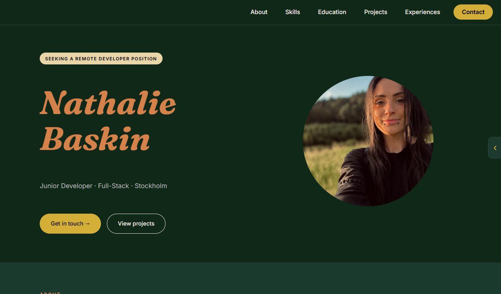
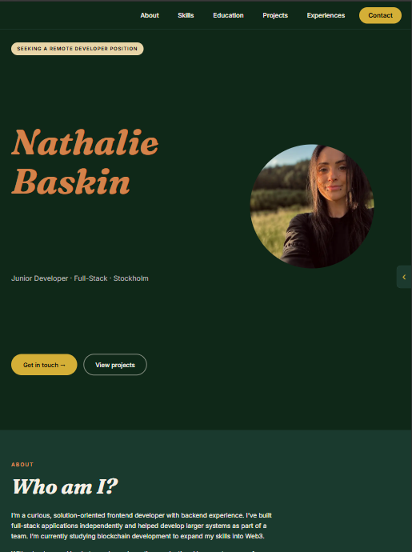
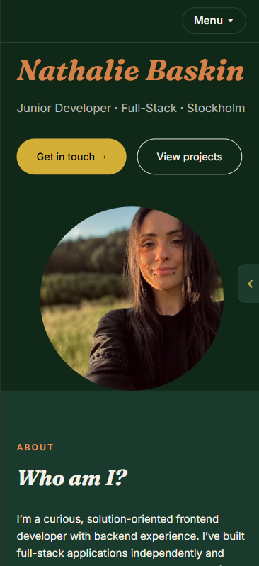
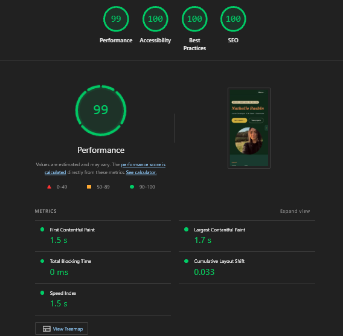
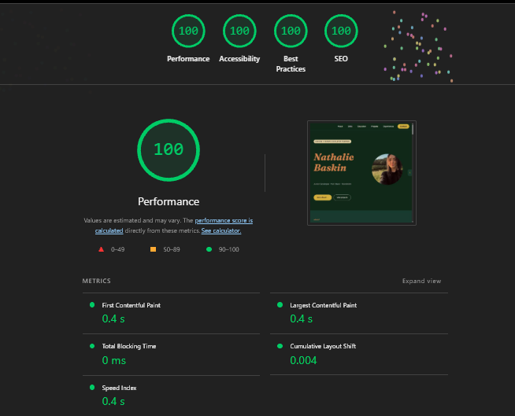
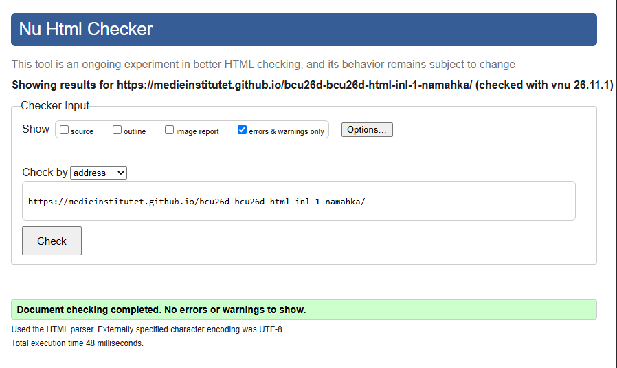
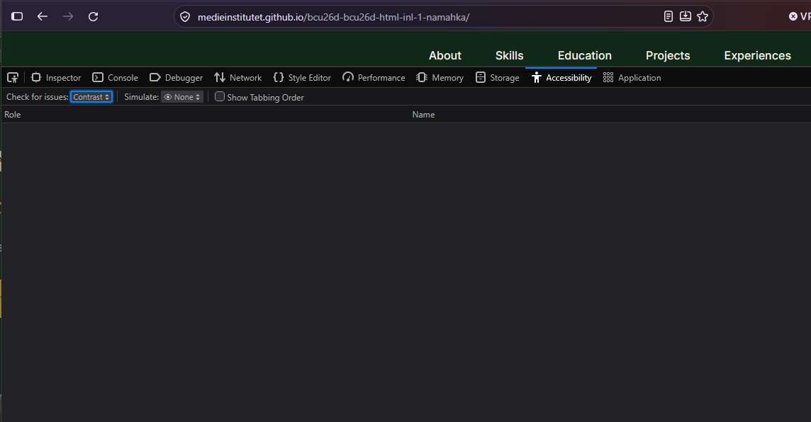
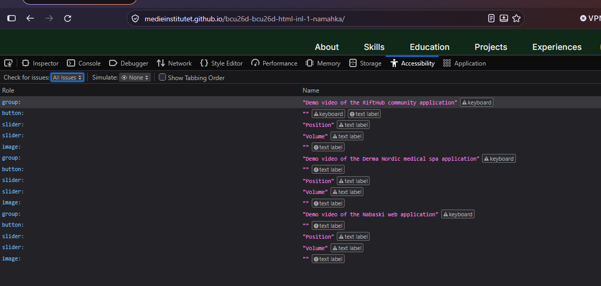

# Nathalie Baskin – Portfolio

A responsive portfolio website where I present myself, my skills, my education and my projects. It is built with semantic HTML and CSS, mobile-first and without JavaScript.

**Live site:** [medieinstitutet.github.io/bcu26d-bcu26d-html-inl-1-namahka](https://medieinstitutet.github.io/bcu26d-bcu26d-html-inl-1-namahka/)

## Preview

  
  
  

## Content

| Section         | Content                                                         |
| --------------- | --------------------------------------------------------------- |
| **Hero**        | Name, role, profile photo and links to contact and projects     |
| **About**       | A short presentation of who I am                                |
| **Skills**      | Backend, frontend, tools and currently learning, grouped with icons |
| **Education**   | Timeline of my studies                                          |
| **Projects**    | Twelve projects with screenshots or demo videos, tags and links |
| **Experiences** | Timeline of my work experience                                  |
## Accessibility review

All tests were run on the published site in a private window so browser extensions didn't affect the results.

### Chrome Lighthouse

| Device  | Performance | Accessibility | Best Practices | SEO |
| ------- | ----------- | ------------- | -------------- | --- |
| Mobile  | 99          | 100           | 100            | 100 |
| Desktop | 100         | 100           | 100            | 100 |

### W3C HTML Validator

No errors or warnings.

### Firefox Accessibility Tools

The contrast check found no issues.

The remaining issues are all inside Firefox's built-in video controls that the browser generates when the `controls` attribute is used. They're not part of my code and every video has its own `aria-label`. Replacing them would require custom JavaScript controls.

## Code decisions

**Popover API for the mobile menu:** The dropdown uses the `popover` and `popovertarget` attributes instead of JavaScript. The browser handles opening, closing and telling screen readers if the menu is open or not. On larger screens my CSS overrides the popover styles so the list is always visible.

**Lighter orange on light green backgrounds:** The original orange `#d4824a` fails the WCAG contrast requirement on the lighter green backgrounds, so small text there uses `#e3925a` which passes.

**Hero grid placement:** On larger screens `.hero > *` places all hero content in the first column. `.hero-photo` has the same specificity but comes later in the file, so it overrides that rule and moves the photo to the second column.

**Uppercase project names:** The project names are written in uppercase in the HTML because that is how the products are named, not as a styling choice. Section labels like "About" and "Skills" are written in normal case and made uppercase with `text-transform` in CSS.

